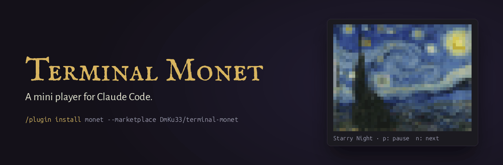
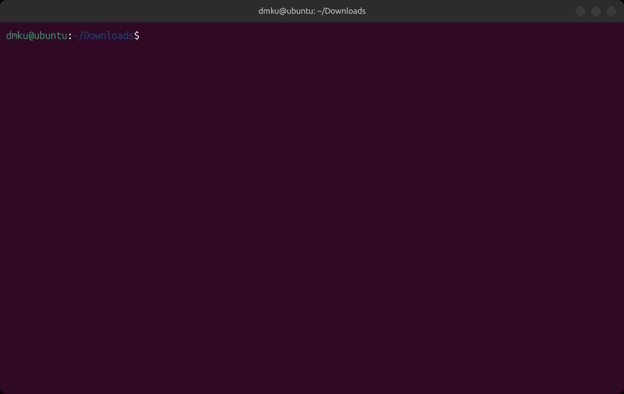

<p align="center"></p>

**Why stare at "Spelunking…" all day?** Monet puts a mini player in Claude Code. Play anything in it: a movie, a GIF, a meme, a plot.

<p align="center"></p>

## Install

```
/plugin install monet --marketplace DmKu33/terminal-monet
```

> [!IMPORTANT]
> **Install ffmpeg first:** `brew install ffmpeg` (macOS), `sudo apt install ffmpeg` (Linux) or `winget install ffmpeg` (Windows). Without it, Monet can't play your clips.

Answer `y` to add the marketplace, then start a new session.

## Add your clips

Put videos, GIFs or pictures in this folder:

| OS | Folder |
| --- | --- |
| Linux | `~/Videos/Monet` |
| macOS | `~/Movies/Monet` |
| Windows | `Videos\Monet` in your user folder |

Monet finds new files within 20 seconds and shuffles them. `/monet folder` opens the folder.

## Good to know

- **Any clip, any length:** mp4, webm, mov, mkv, GIF, PNG or JPG. A full movie works.
- **Disk:** about 11 MB for each minute that plays. The cache stops at 300 MB, and you can change the limit.
- **CPU:** a 1080p movie uses about 12% of one core. ffmpeg converts about 20 seconds at a time, only while the clip plays.
- **Memory:** about 7 MB in Claude Code.
- **Tokens:** zero. Monet shows itself, so you type nothing.
- **Terminals:** a color mosaic in any terminal, real pixels in kitty and Ghostty. Linux, macOS and Windows.

## Commands

| Command | What it does |
| --- | --- |
| `/monet` | Shows or hides the player. |
| `/monet next` | Plays the next clip. |
| `/monet side`, `/monet bottom` | Puts the player at the side or at the bottom. |
| `/monet theme` | Paints the whole side panel in your terminal's color. Pick **Monet** in the list. |
| `/monet settings` | Look, frame rate, folder, disk limit and more. |

[Full guide](docs/guide.md) · [MIT License](LICENSE)
